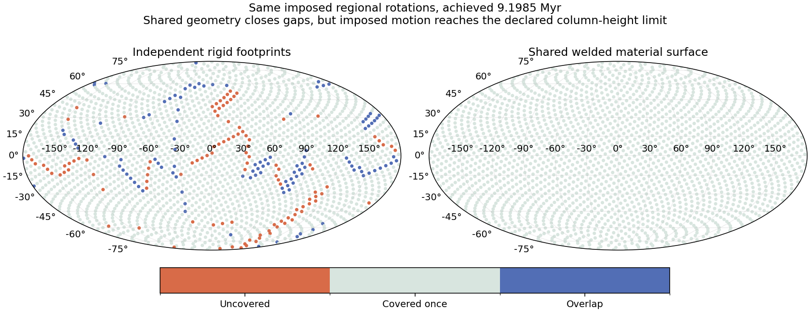
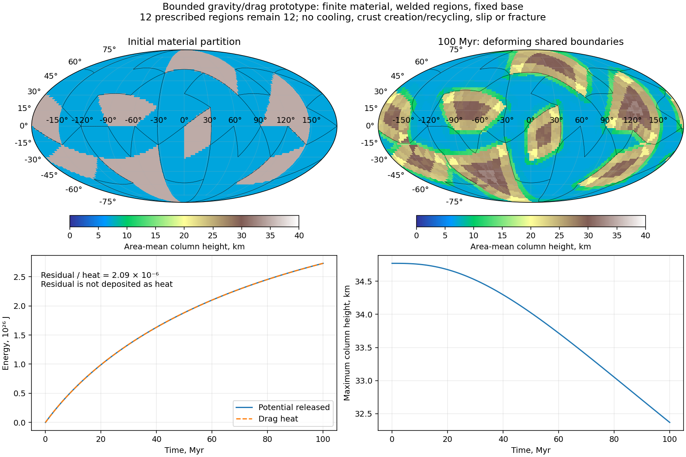
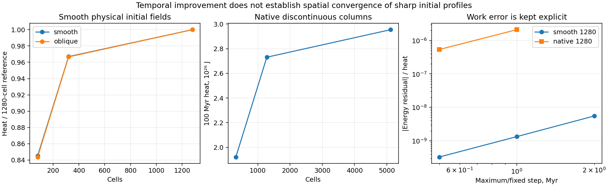

# Shared boundaries: bounded reconstruction result

The shared, deformable material surface removes gaps and overlaps in the
tested motions without reallocating or deleting material. A dimensional
gravity/drag control evolves the native initial inventory for 100 Myr and
accounts for its work. This establishes a usable geometric/material building
block, **not a completed tectonic runtime**. The existing runner is unchanged.

Implementation commits: `9be97985b96314c735278b2ed09abafcb721f49b` and
`20d974f6a51deb28953da7c5bfbd3e3f0cdd6278`, on
`reconstruction/regional-20261113`. Parameters, actual runtime hashes and
source commits are recorded with each result. Some controls ran between these
commits; their file hashes identify the exact working implementation. A fresh
process using the second commit reproduced the native result bit for bit.

## What changed, and what the comparison establishes

`tectonics/conforming_surface.py` uses one spherical vertex position and one
complete tangential velocity shared by all incident material triangles.
Regions deform and remain welded: neither independent rigid plates nor
tangential slip is represented. Exact spherical areas determine column
thickness; material volume, ownership, age moments and inherited inventories
stay attached to faces. Geometry is checked, never repaired by normalizing
areas. The source state is the protected, zero-time `initial_same_g2` inventory.
An evolved rigid-overlap checkpoint cannot be imported as a closed surface.

The alternatives and equations are in [METHOD.md](METHOD.md). The bounded
comparison uses the **same initial regional Euler vectors held constant** in
both geometries; it is not a replay of the earlier dynamically driven 20 Myr
history. At the achieved 9.198486 Myr:

| Diagnostic | Independent rigid footprints | Shared welded surface |
|---|---:|---:|
| Uncovered sample points / 2048 | 110 | 0 |
| Multiply covered sample points / 2048 | 111 | 0 |

These are point-coverage diagnostics, not exact defect areas. Shared edges,
positive orientation and total spherical area provide separate geometric
checks. The imposed-motion control stops before the requested 20 Myr because
its tallest column approaches the declared `h/R < 0.02` applicability limit
(105.715 km). No clipping, mass deletion or relaxed geometry tolerance is used.
Its imposed deformation requires external work, explicitly recorded as
6.671390e24 J; the work residual is 1.068205e11 J, or 1.60e-14 of that exchange.
It generates no diagnostic heat. Projecting old velocities closes geometry
but does not make those velocities a sustainable force solution.

## Finite-energy motion on the native inventory

The unforced control derives force from column gravitational potential and
uses positive basal drag. The fixed radial support does no work. Heat is the
independent time integral of drag dissipation; the remaining work defect is
reported separately. The initial gravitational potential is **newly declared**:
the old model did not own this mechanical energy, so this is not a conservative
conversion of an old total-energy history. Existing sensible heat is retained.

At 1280 material cells, with synthetic drag coefficient 1e17 Pa s/m:

| Quantity | Initial | At 100 Myr |
|---|---:|---:|
| Felsic volume, m³ | 3.455143927710239e18 | unchanged |
| Basalt volume, m³ | 1.7677900132812224e18 | unchanged |
| Mass, kg | 1.4800994036104215e22 | unchanged |
| Gravitational potential, J | 1.327796269393507e27 | 1.054718012324501e27 |
| Integrated drag heat, J | 0 | 2.730788290423690e26 |
| External work, J | 0 | 0 |
| Tallest column, km | 34.770823 | 32.367433 |
| Prescribed material regions | 12 | 12 |

The energy defect is **+5.719734e20 J**, or **2.09454e-6 of dissipated energy**.
It is not deposited as heat. The diagnostic heat increment is 15.375 K; it
does not yet feed back into viscosity or the main thermal model. Across the
23 saved controls, the maximum relative total-area residual is 2.22e-16.
Volume and provenance arrays are unchanged; age moments advance with time.
The full inherited thermal inventory remains available in restart provenance.
This does not recover missing Maxwell or elastic history from older work.

## Accuracy, sensitivity and restart

* The full available suite passed: **353 tests**, one third-party deprecation
  warning, 15.99 s (`final_tests.log`). Thirteen new tests cover independent
  radial energy integration, virtual work, rotation covariance, zero internal
  torque, quiet equilibrium, dissipation, step convergence, invalid geometry,
  initialization, material preservation and restart. The seven historical
  failures mentioned in lost-session history are absent from this recovered
  baseline; this stage does not claim to have fixed them.
* Halving the native adaptive maximum step from 1 to 0.5 Myr changes total heat
  by 1.01e-6 relative and reduces the exchange-scaled energy defect from
  2.09e-6 to 5.35e-7. Smooth fixed-step controls at 2, 1 and 0.5 Myr also show
  approximately second-order work error.
* The independent small-amplitude degree-two spherical-harmonic decay limit
  has relative rate errors 8.75%, 2.24%, 0.564% on 80, 320, 1280 cells.
  Smooth and oblique finite-amplitude cases use conservative aggregation of
  the same fine reference profile. Their 320-to-1280 heat differences are
  about 3.4%; this is measured refinement, not a universal accuracy guarantee.
* The native sharp profile remains spatially sensitive:

| Cells | Heat at 100 Myr, J | Maximum height, km | Case wall time, s |
|---:|---:|---:|---:|
| 320 | 1.922151e26 | 33.015544 | 0.536 |
| 1280 | 2.730788e26 | 32.367433 | 1.305 |
| 5120 | 2.953890e26 | 32.255265 | 4.262 |

The last heat change is **8.17%**. Spatial convergence of this discontinuous
initial state is not established. Better time integration does not remove it.
All three start with the same parent material inventory and boundaries.

* Drag sensitivity at 1e16 and 1e18 Pa s/m gives maximum heights 22.128 and
  34.755 km, and dissipated energies 4.978899e26 and 5.607081e25 J. The available
  initial energy is unchanged. These parameters are synthetic and uncalibrated;
  neither a plate speed nor a geological timescale has been validated.
* Restart at the reference's actual accepted time 50.75 Myr reproduces all
  arrays and metadata at 100 Myr exactly. The next step, compensated ledgers,
  identities and material memories represented by this model are saved. A
  next-representable-time test also integrates a tiny terminal interval.

## Cost, preservation and failures retained

A fresh Python process completed the 1280-cell, 100 Myr control in **1.87475 s**,
peak RSS **77.914 MiB**, including initialization, save/restore and coverage
diagnostics; integration alone took 1.1034 s. This is about 53.3 model Myr per
wall second **for this limited operator**. It excludes cooling, crust exchange,
fracture, remeshing and GUI. It is not a like-for-like speedup of the old full
runner and cannot be extrapolated to a complete tectonic history.

The 23 recorded case times sum to 19.10 s (not total development wall time).
There are 23 restart directories, 46 files, 1,427,837 bytes. Reports, logs,
parameters and three inspected figures keep the whole stage below 3 MB.
`preservation.json` verifies all **565 previously manifested artifacts**;
the preceding runner/source hashes are unchanged. All 264 original baseline
paths remain; its eight differences are the already committed earlier work.

Failed attempts are retained explicitly. `native.log` records the initial
missing optional area inventory, fixed by declared zero-time initialization
from existing material. `kinematics.log` records insufficient 5/9-point work
quadrature; 17/33-point refinement resolved that numerical error without
changing its tolerance. `prescribed_work_failure.json` records the independent
quadrature comparison. The subsequent prescribed-motion applicability stop is
a genuine bounded result, not an unfinished successful 20 Myr run.

## What is still required for the original goal

This is a cheap, conservative geometry/material reference with a finite work
source. It has no independent tangential slip, elastic strength, thermal
contraction, crust creation/recycling, fracture or topology events. The 12
regions are prescribed and remain 12. Constant gravity, fixed support and
basal-drag rheology do not represent the full mantle or realistic lithosphere.

The next useful integration is a **coarse deformation/work law in finite-width
boundary regions**, using actual material area change and stress work, with
the existing finite thermal and crust-exchange inventories. Old jumps between
independent Euler velocities cannot be reused as opening rates on this shared
surface. Tangential slip requires separate side coordinates and a consistent
contact law. Those choices must be explicit before replacing the main runner;
they should preserve this operator as a geometric and energy reference rather
than return to microscopic seam mechanics. Resolve the measured sharp-profile
area/work sensitivity as part of that coupling; do not hide it by normalizing
the map or selecting a convenient resolution.
