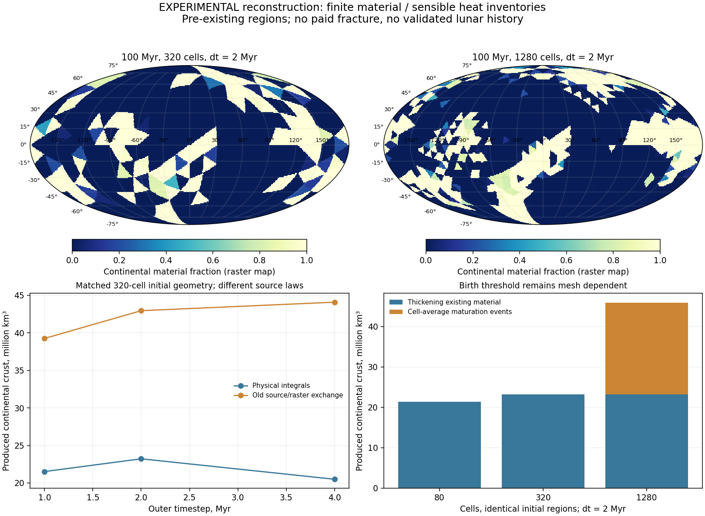

# Integral crust exchange: new reconstructed result

13 November 2026; branch `reconstruction/regional-20261113`.
Final numerical runtime: `ba4965efa4031386264f1e071ba78e64ae19523e`;
an additional restart-save validation was subsequently tested. Parent evidence:
`88d5b52ed72b2f6655d227f500344ac69719064c`.

The existing global runner now has optional boundary-integrated crust sources
and finite-column basalt sinks. A major timestep dependence of gross basalt
production was removed, and existing-material arc thickening is much less
spatially sensitive. **The complete model is still not converged or ready for
paid fracture.** Maturation uses cell-average history; the raster transport
does not place newly supplied basalt consistently into the newly opened area.
All calculations below are new reconstructions, not recovered historical runs.

## What changed

- Fixed physical arc width and geodesic line integration replace mesh-broadened
  point kernels. Source contributions add; physical area outside the overriding
  region is reported. This is an explicit effective source-law revision, not
  merely a faster evaluation of the old maximum-of-kernels model.
- Thickening counts the continental footprint once, rather than twice. Partial
  coastal material thickens even when its visible cell label is oceanic.
  Maturation retains existing continental volume and funds only the new footprint.
- Ridge/trench exchange uses physical length and normal speed. A mixed donor
  column has V'=S-kV, k=|v_n|L/A, with an exact frozen-coefficient update and
  conserved age moment. All basalt parcels survive raster advection; overlap
  alone is no longer a second recycling event, and gaps do not fabricate basalt.
- Born/returned volumes use the existing finite mantle/crust sensible-enthalpy
  ledger. The new law and basalt age moment are saved and required on restart.
- A high-order quadrature check exposed ordinary summation error when many
  weights entered one coarse cell. Grouped `math.fsum` fixes it without relaxing
  the conservation tolerance or assigning a residual to the source.

Physical parameters and event thresholds were not tuned for a desired outcome.
The initial synthetic world still has 12 existing regions. All nonempty-region
splits and mergers remain disabled in this inventory control.

## Comparable 100 Myr results

The same newly initialized 80-cell geometry was conservatively subdivided into
320 and 1280 cells. Regions, Euler poles, extensive inventories, initial thermal
history and water stock are shared. Boundary length is 159,538.612756769 km on
all three grids; maximum parent-area discrepancy is 2.80e-9 km² and the summed
extensive-field differences round to zero (`initial_refinement.json`).
This refines a zero-time piecewise-constant state, not an evolved historical save.

| Cells | dt, Myr | Continental production, million km³ | Existing-material thickening, million km³ | New continental footprint, million km² | Basalt born / returned, million km³ | Whole process, s |
|---:|---:|---:|---:|---:|---:|---:|
| 320 | 4 | 20.499 | 20.499 | 0 | 1691.594 / 1652.449 | 15.62 |
| 320 | 2 | 23.220 | 23.220 | 0 | 1671.680 / 1499.586 | 21.36 |
| 320 | 1 | 21.523 | 21.523 | 0 | 1632.843 / 1419.119 | 32.20 |
| 80 | 2 | 21.383 | 21.383 | 0 | 1588.685 / 1407.999 | 16.56 |
| 1280 | 2 | 45.916 | 23.154 | 0.875470 | 1908.235 / 1783.192 | 31.05 |

At 320 cells, the matched old source/raster-exchange laws give basalt production
2079.315/2493.268/3054.271 million km³ at dt=4/2/1, a 46.9% increase as the step
shrinks. The integral law gives 1691.594/1671.680/1632.843, a 3.5% decrease.
This is a useful reduction, **not a proved convergence order**. Its returned
basalt still changes by 14.1% between dt=4 and 1, and the dt=2→1 change is 5.4%.
Continental production remains non-monotone in dt; its 12.6% spread relative to
the dt=1 value is not better than the matched old-law spread (~12.3%). Both law
changes and numerical corrections are present, so the lower total production
is not itself a measure of greater geological accuracy.

At dt=2, existing-material thickening changes only -0.287% between 320 and 1280
cells, versus +8.59% from 80 to 320. The excess 22.762 million km³ on 1280 cells
is exactly the juvenile event contribution. This explains the near doubling of
total continental production without attributing it to chaos. Basalt production
and return still rise 14.2% and 18.9% between 320 and 1280 cells. Those flows and
the moving map are not spatially converged.

Final maximum displayed thickness is 35.25/43.90/80.58 km at 80/320/1280 cells
(dt=2). Final area-weighted RMS surface speed is 30.99/30.98/27.65 mm/yr.
These are outputs of uncalibrated force proxies, not validated lunar speeds or
thicknesses. There are 12 regions at every endpoint; juvenile crust is not a
new plate and no spontaneous split is claimed.



## What the independent diagnostics establish

The fixed-strip source integral is 989,360.4036668305 km² (weighted source area).
It is independent of receiving grid, segment partition and rigid rotation.
Default order-8 quadrature differs from the independent scalar integral by
1.45e-9 relative; higher orders reach roundoff. However, **deposition into
individual cells has discontinuous receiver masks**: order-8 versus order-32
L1 differences are 0.11/0.83/1.96/5.07% at 80/320/1280/5120 cells, and are not
monotone with quadrature order. Order 32 is a comparison, not a rigorous bound.

For one fixed physical strip, the unchanged control parameters predict a
pointwise matured area of 1,151,975 km² at 100 Myr. The actual cell-mean rule
gives zero at 80/320/1280 cells and only 64,625 km² at 5120, first appearing in
the step ending at 96 Myr for both dt=2 and 1. Thus shrinking the time step
cannot repair the missing subcell history. This is an analytic diagnostic of
the thresholding approximation, not a new full-runtime geological forecast.

The older default-parameter diagnostic is retained separately as
`operator_diagnostics.json`; the matched-control evidence is
`operator_diagnostics_control.json`. Initial centroid-versus-edge-normal errors
are small (mean tilt ~0.227°; initial opening integral changes <0.04% at the
finer grids). They do not explain the large threshold discrepancy. The runtime
classifier was not changed on this evidence.

The positive analytic donor update agrees with independent Radau integration
and with subdivided time updates for k=0 through 100/Myr, including the tiny-k
limit. Constant line-opening flux is invariant on the same nested physical
boundary. A separate raster-overlap control has exactly zero gross exchange
and conserves total basalt volume and age moment.

## Balances, restart and regressions

- **285 tests passed**, one dependency deprecation warning
  (`final_verified_pytest.log`). A preceding new checkpoint-test fixture
  incorrectly tried to reinitialize an existing inventory; the existing guard
  rejected it. The fixture now explicitly starts fresh; the failed log is kept.
- 48→100 Myr restart matches the uninterrupted calculation **bitwise in all 64
  arrays and all metadata**, including the law, age memory and thermal controller.
- With the new options disabled, the original September control remains bitwise
  identical through 20 Myr: **62 arrays and metadata**. The historical seven
  baseline failures are not present in this recovered checkout; its original
  baseline had 218 passing tests.
- Independent 60-digit Decimal sums of saved native geometry and gross process
  transfers give maximum final volume residuals 5.10e-7 km³ (continental plus
  sediment) and 2.90e-7 km³ (basalt) across the five final cases. Global origin
  pools are conserved. They track initial origin classes, **not spatial element
  chemistry or full material cohorts**.
- Independent sums of compensated stored sensible energy, radiogenic/orbital
  inputs and surface losses give **0 J arithmetic residual**. That does not
  establish zero integration error or complete thermodynamics. For 320 cells,
  dt=2: gross created/returned mass is 4.91289e21/4.71914e21 kg; outgoing/returned
  advected sensible heat is 1.09329e28/2.29307e27 J; surface loss 6.59893e28 J,
  radiogenic input 2.73348e28 J and prescribed orbital input 9.59729e27 J.

Mechanical work/GPE, latent heat and chemical differentiation are still outside
the ledger. Their residual is **unknown**, not zero. The orbital source is
prescribed, not a self-consistent orbital-energy history. The two-box thermal
model has no established lunar phase-validity range at these temperatures.

## Main practical limitation and next step

Removing raster-created matter exposes the geometry defect: up to 15.0–21.6%
of total area is an unfilled oceanic footprint in these controls, compared with
0.36–0.64% under the old raster source/sink. All mass is retained, but it is
concentrated elsewhere; a large empty fraction and zero minimum local thickness
are **not a prediction of exposed mantle**. The thermal box still assumes an
effective distributed crust. These maps therefore cannot be used as a resolved
surface heat-loss or geological boundary solution.

The shortest useful continuation is a finite **regional active-material
inventory on physical boundary strips**, owning occupied area, basalt amount,
age/arc maturation history and transfers into the coarse displayed cells.
Opening must create available area and place only the funded source there;
closure must return the corresponding material. Maturation must act on that
active material before coarse-cell averaging, without converting an entire cell
for a narrow arc. Preserve unresolved material history through motion instead
of globally refining the display. Acceptance should require same-geometry
birth/return volumes and event histories across grids, closing occupied-area
and mass budgets, and no manufactured source under rigid rotation. This is a
specific remaining regional discretization task, not a call for microscopic
seams or a 3-D geodynamics solver.

Paid mechanical fracture is consequently **not implemented here**. The recovered
force law still uses proxy coefficients and a deg/Myr response scale; it has no
common SI elastic potential/reference strain/viscous memory. An honest next
mechanical stage must derive forces and topology-release work from one regional
potential and initialize new memory explicitly. Subtracting arbitrary bulk
thermal energy or relabeling daughters would not solve that missing coupling.

## Cost and durable reproduction

The five final 100-Myr cases took 15.62–32.20 s per complete process, with
5.72–22.92 s inside the global loop and 201.5–218.2 MiB peak RSS. That is
3.1–6.4 Myr per whole-process second. The new integration roughly doubles loop
cost against the matched old source law at 320 cells; no speedup is claimed.
No Gyr extrapolation was run. Each child had a 120-second cap; all completed.

Seven independently copied native state pairs total **3,456,321 bytes**, including
three common initial grids, a 48-Myr restart and three 100-Myr endpoints. They
are separate files, not archive hardlinks. Parameters, measurements, raw logs,
the map and SHA256/source manifests are kept with this report and pushed to the
working branch. Earlier source-summation runs (`same_*`) remain as development
evidence; final measured cases are `final_*`. No prior result is overwritten.
The compact evidence is about 4.2 MB; all new raw outputs total 67.2 MB. Around
30 GiB remains free. All 129 files covered by the two preceding evidence
manifests retain their hashes; none of the original 264 inventoried files is
missing. Seven source files differ intentionally from the recovered baseline.

Example from the repository root, with a new destination:

```bash
MPLCONFIGDIR=/tmp/hm_reconstruction_mpl .venv/bin/python run_long_evolution_v131.py \
  --config analysis/integral_arcs_20261113/final_g2_dt4.yaml \
  --resume analysis/integral_arcs_20261113/saved_states/final_first48 \
  --dt 4 --end-time 100 --output outputs_v131_integral_arcs/my_restart \
  --checkpoint outputs_v131_integral_arcs/my_restart/restart
```

Use `saved_states/initial_same_g2` with the matching dt=1/2/4 configurations for
a complete new 100-Myr run. The verification harness refuses to overwrite case
paths; choose new names when reproducing its queue. The raw earlier environment's
lost archives cannot be recertified. `preservation.json` records the existing
checkout/evidence checks; no unavailable old experiment is claimed restored.
