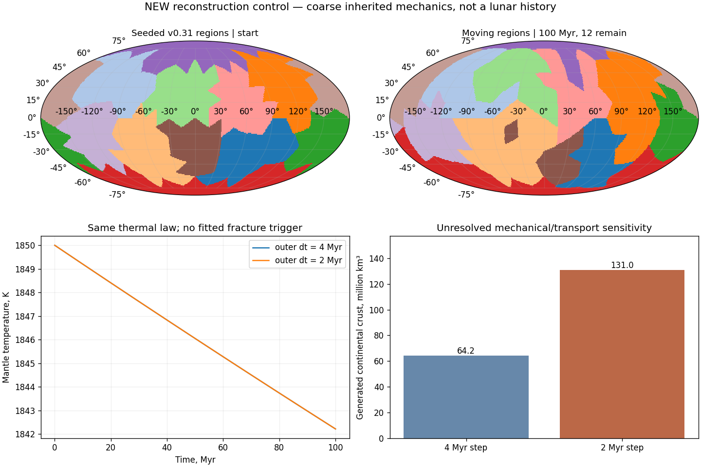

# Новый этап реконструкции — 13 ноября 2026

Среда восстановлена, но содержит сентябрьскую базу `831e6e3`, а не утраченную
экспериментальную ветку. Работа ведётся в `reconstruction/regional-20261113`.
Карта восстановленных сведений, неизвестного и последующих работ:
[RECONSTRUCTION.md](RECONSTRUCTION.md). Прежние результаты не объявляются
воспроизведёнными. Исход старой очереди оплаченного разреза остаётся неизвестным.

## Что подключено

В основной цикл, вызываемый `run_long_evolution_v131.py`, добавлен **необязательный
интегратор теплового бюджета**. Он использует прежние зависимости вязкости,
теплоотдачи, радиогенного и приливного нагрева. Численный шаг выбирается по оценке
ошибки методом удвоения шага Heun; неудачная попытка откатывается. Известные узлы
заданной истории эксцентриситета становятся границами подшагов. Даже малый
конечный интервал доводится до точного представимого конечного времени.

Радиогенный приток, внешний орбитальный приток, поверхностная потеря и изменение
внутренней энергии учитываются раздельно. Суммы и их компенсации сохраняются
вместе с контроллером. Остаток не превращается в тепло. Нет искусственного
температурного пола: за пределом применимости расчёт завершается ошибкой без
изменения входного состояния. Новый бюджет при запуске со старого состояния
имеет явно записанное начало; прошлые потоки не восстанавливаются из воздуха.
Неполный новый checkpoint отклоняется, а его история не заполняется догадками.

**Область проверенного:** один конечный, хорошо перемешанный тепловой резервуар
мантии постоянной массы с заданными внешними поступлениями. Это ещё не общий
энергетический баланс тектоники. Работа старых условных сил, энергия раскола,
масса и энтальпия рождающейся/поглощаемой коры с ним пока не сопряжены.
Фазовая история при 1850 K этим эффективным законом не устанавливается.
Контроллер проверяет тепловую ошибку, а не гарантирует локализацию разлома.

## Новые измерения

Измеренные расчёты использовали runtime-коммит
`f32900cb2bcd7ac2e4ccd264be997a78bf1a8af9`; последующая
проверка неполных checkpoint не меняет решений для корректных состояний.
Параметры и журналы лежат рядом. Не менялись физические коэффициенты ради событий.

| Ячеек | Внешний шаг, Myr | Горизонт, Myr | Цикл расчёта, с | Процесс целиком, с | Пик RSS, МиБ | Плиты в конце |
|---:|---:|---:|---:|---:|---:|---:|
| 80 | 4 | 100 | 0,878 | 11,40 | 194,4 | 13 |
| 320 | 4 | 100 | 1,763 | 12,25 | 192,3 | 12 |
| 320 | 2 | 100 | 3,621 | 14,36 | 201,4 | 12 |
| 1280 | 4 | 100 | 4,268 | 14,81 | 207,4 | 12 |

Время процесса включает инициализацию, checkpoint и многочисленные штатные
графики. Для 320 ячеек это **56,7 Myr/с в цикле** или **8,17 Myr/с целиком**.
Это измерение более простой сохранившейся модели; сравнивать его с прежними
148–205 с на 1 Myr как ускорение того же алгоритма нельзя.

Температура мантии: 1850 → **1842,219909 K**. Разность между шагами 4 и 2 Myr:
**1,614·10⁻⁶ K**. На разных сетках при одинаковом шаге тепловой результат совпал:
этот резервуар пространственно однороден. Начальная механическая геометрия при
изменении сетки также меняется, поскольку старый генератор использует случайные
ячейки. Таблица является проверкой работоспособности/стоимости, **не доказательством
пространственной сходимости геологии**.

При 320 ячейках за 100 Myr (Дж):

| Статья | Значение |
|---|---:|
| Радиогенный приток | 2,7334824834·10²⁸ |
| Заданный орбитальный приток | 9,5972898977·10²⁷ |
| Поверхностный отток | 5,5889531703·10²⁸ |
| Изменение внутренней энергии | −1,8957416971·10²⁸ |

Компенсированный остаток этой дискретной бухгалтерии — 0 Дж. Независимое
вычисление изменения энергии через округлённую скалярную температуру отличается
на −1,0254·10¹⁴ Дж; это явно отражено в результатах, а не скрыто.
Тест двухчасового интервала отдельно сравнивает малый обмен с 70-разрядной Decimal
арифметикой: относительная ошибка <5·10⁻¹⁶. Машинная бухгалтерия не является
оценкой физической точности теплового или тектонического закона.

Прежние объёмные ledgers континентального материала и магматических продуктов
сохранились: максимальные остатки соответственно 9,54·10⁻⁷ и 6,99·10⁻¹⁰ км³.
Это **не** проверка полного химического/массового баланса мантии и коры.

## Существенное незакрытое расхождение

На одних и тех же 320 ячейках уменьшение внешнего шага 4 → 2 Myr изменило
образование континентальной коры **64,15 → 131,04 млн км³ (×2,043)**.
Суммарная площадь молодых дуг изменилась 1,037 → 3,153 млн км²; число дискретных
переносов — 111 → 201; суммарная площадь открытых океанических ячеек —
327,51 → 393,95 млн км². Причина в полной цепочке сил, дискретного переноса и
пороговых процессов ещё не разделена. Малое расхождение температуры само по себе
не устанавливает единственную причину. Коэффициенты не корректировались.

На 320/1280 ячейках новых областей нет. На 80 ячейках сработал старый
`disconnect_split`: это эвристическое выделение несвязной области, **не новый
энергетически оплаченный разлом**. Начальные области уже заданы генератором.



## Проверки и сохранность

- Исходная версия: 218 тестов прошли. Первые 2 падения и 8 ошибок оказались
  отсутствующим штатным PySide6; после установки зависимости они исчезли.
  Исторические «семь baseline failures» относятся к недоступной другой версии.
- Новая версия: **234 теста прошли**, 1 предупреждение; лог `final_tests.log`.
  Проверены аналитическое охлаждение и второй порядок, последовательность
  допусков, нулевые и радиогенные потоки, короткий заданный приливный импульс,
  двухчасовой остаток времени, отказ/откат и сериализация контроллера.
- Полный глобальный restart **48 → 100 Myr** совпадает с непрерывным запуском:
  все **62 массива побитово**, все метаданные одинаковы. Отключение бюджета при
  таком restart явно запрещено. Сохраняется существующая материальная память;
  новая неизвестная упругая память не выдумывается.
- Старый режим без нового флага сравнён с нетронутым `831e6e3` на 20 Myr:
  те же 62 массива и метаданные совпали побитово.
- Все 264 исходных tracked-файла на месте; 262 неизменны по SHA-256. Два
  намеренных изменения — общий runner и формат checkpoint. Старые результаты,
  архивы и данные не удалялись. Утраченные защищённые файлы недоступной среды
  проверить здесь невозможно.
- Три небольших restart-состояния, карта, таблицы, YAML и журналы сохранены
  отдельно в этой папке; общий размер около **2,4 МиБ**. Хеши и source commit:
  `artifact_manifest.json`. Остальные рабочие графики сохранены локально.

Первый запуск измерительного скрипта не начал расчёт из-за отсутствия
`/usr/bin/time`; заменён на штатный `wait4`. Первые файлы не удалены.
Ошибка имени массива в построителе карты исправлена после уже завершённых
расчётов; имеющиеся копии checkpoint перед повтором проверены побайтно.

## Практический следующий этап

Сначала разделить влияние движения, дискретного переноса и порогов на потоки
коры на **одинаковом материальном состоянии**. Затем заменить учёт геометрически
созданной коры явным запросом к конечному донору массы и энтальпии, сохранив
проверенный быстрый глобальный цикл. Для сеточной проверки нужна одна заданная
физическая геометрия, проецируемая на разные сетки. После этого можно возвращать
региональную упругую/вязкую память и оплаченный критерий новых границ.
Уточнять уже достаточно точную температуру или запускать Gyr сейчас не полезно.

Запуск нового режима:

```sh
.venv/bin/python run_long_evolution_v131.py \
  --config analysis/reconstruction_20261113/coarse_thermal.yaml \
  --end-time 100 --dt 4 --output outputs_v131_new_run
```

Для продолжения сохранённого результата используйте тот же YAML, шаг и новый
каталог вывода, добавив `--resume analysis/reconstruction_20261113/saved_states/measured_grid2_dt4`
и `--end-time 104`. Конец сегмента пока должен быть кратен внешнему шагу старого
runner; внутренний тепловой интегратор умеет произвольный конечный интервал.
GUI нового режима и новая модель рождения плит на этом этапе не подключены.
