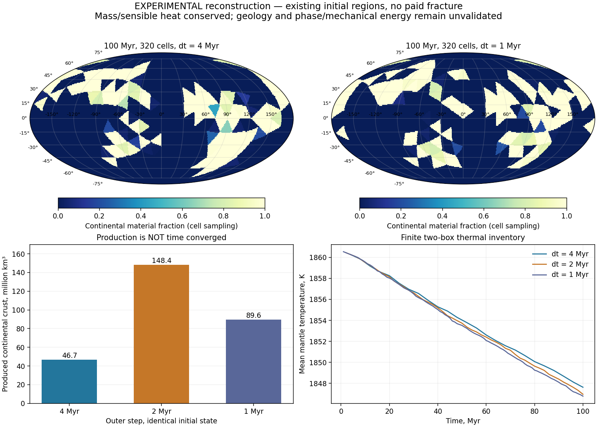

# Reconstructed material and thermal exchanges: verified result

13 November 2026. Branch: `reconstruction/regional-20261113`.
Runtime source: `1fc1d71409f715612de70f750f3b484a15bdcb7f`.
Parent: `06a077af58bc0731017ad33e4bc559a0482ada4d`.
These are **new results**, not recovered October–November experiments.

The existing global runner now has a tested optional finite mantle/crust
inventory. Numerical defects in basalt transport and arc maturation were fixed.
**The coupled production of crust is still not converged in time or space, and
physically paid fracture has not been reconstructed.** The experiments therefore
support conservation and numerical diagnosis, not a validated lunar history.

## Changes actually integrated

- Basalt has an extensive volume and shares the existing material transport map.
  A stationary variable-thickness ocean no longer resets to 7 km in the new mode.
  Unequal destination areas change thickness instead of silently losing volume.
- A rigid mixed-coast rotation exposed a second numerical source: the initial
  reconstruction manufactured 9.958 million km3 of basalt to fill fractional
  raster coastlines. The correction creates basalt only at modeled gaps/breakup.
  The rigid-rotation test now has exactly zero creation/recycling.
- Arc maturation integrates dP/dt = S - P/tau analytically at frozen forcing,
  resolves the threshold crossing within the step, and thickens for the remaining
  time. No production coefficient or threshold was tuned. Oversized thickening
  increments reject the step instead of clipping its production.
- Mantle, basalt, and continental/sediment rock-equivalent masses are finite.
  Creation and recycling transfer the donor's sensible specific enthalpy cp*T.
  Compensated origin inventories retain three global material-origin classes.
  Exhaustion/inconsistent requests fail atomically rather than replenish a pool.
- Two thermal reservoirs replace, rather than supplement, the old thermal owner.
  The initial crust is carved from the old effective mass and heat inventory.
  The combined boundary-layer resistance is preserved; basal heat exchange has
  opposite signs on its two sides. Sources, outgoing heat and advected energy
  are separately accumulated. No numerical residual is deposited as heat.
- Checkpoints save basalt volume, temperatures through their energy inventories,
  provenance sums and thermal-controller memory. Legacy modes remain available.

The fixed cp/density, mean-column reduction, initialization and sources are
specified in [METHOD.md](METHOD.md). Partitioning the old 1850 K thermal inventory
gives an initial mantle temperature of 1860.640 K in the 320-cell scenario;
this is a new conservative initialization, not unexplained warming during time
evolution. The total initial sensible energy is 4.507816560e30 J.

## What the comparisons show

All following runs actually reached **100 Myr**, after the coastal correction.
At 320 cells the initial state and physical parameters are identical across dt.
Times include no concurrent numerical experiment in this final series.

| Cells | Step, Myr | New continental material, million km3 | New juvenile footprint, million km2 | Final mantle / crust, K | Loop / whole process, s | Peak RSS, MiB |
|---:|---:|---:|---:|---:|---:|---:|
| 320 | 4 | 46.746 | 0 | 1847.620 / 416.258 | 2.80 / 12.64 | 201.1 |
| 320 | 2 | 148.374 | 4.148 | 1846.949 / 428.675 | 5.76 / 15.25 | 216.2 |
| 320 | 1 | 89.648 | 2.074 | 1846.770 / 402.478 | 11.64 / 21.22 | 218.6 |
| 80 | 2 | 72.128 | 0 | 1847.580 / 398.996 | 3.39 / 13.16 | 196.2 |
| 1280 | 2 | 39.826 | 0.309 | 1847.551 / 404.777 | 10.28 / 19.87 | 216.8 |

Gross creation differs from net crust growth. In the 320-cell, 2-Myr run the
40.532 million km3 of arc thickening is included in the 148.374 million km3 of
total continental production. Basalt creation/return is 2.547/2.436 billion km3.
Some continental rock is also returned through the sediment/rift bookkeeping.
Final maximum visible crustal thickness is 34.92 km. The twelve initial region
labels remain twelve; juvenile crust is **not** a new plate or continent.

The same initial state has 108, 186 and 319 raster transport commits at steps
4, 2 and 1 Myr. The non-monotonic production sequence is not a demonstrated order
of convergence and is not explained away as chaos. Thresholds amplify changes
in sampled arc forcing, material remapping and subduction memory. Smaller
thermal integration error alone cannot fix this.

Isolating only the analytic maturation correction in the previous thermal mode
gives 64.165/102.991 million km3 for dt=4/2, versus 64.154/131.037 before. Thus it
removes a real numerical bias but does not explain or eliminate the whole prior
factor-of-two difference. The full finite-inventory mode changes initialization,
basalt geometry and topology permissions too; it is **not** an isolated accuracy
or speed comparison against that previous mode.

80/320/1280-cell global worlds are seeded separately by the old initializer.
Those rows are **resolution/scenario sensitivity**, not strict same-geometry
spatial convergence. Independent same-physical-data controls instead show:

1. Uniform forcing and maturation on 80/320/1280 cells, dt=4/2/1, gives event-time
   error at most 1.96e-14 Myr and total generated-volume spread 3.82e-6 km3 out of
   9.203e9 km3. This is a numerical operator test, not natural fracture.
2. An identical isolated arc kernel with physical sigma=140 km, cutoff=320 km,
   has analytic area integral 114,093.774 km2. The existing code broadens sigma
   to max(140 km,0.45*cell_scale) **without reducing its amplitude**. The sampled
   integral is 49.65, 10.80, 2.59 and 1.002 times the physical integral on
   80/320/1280/5120 cells. Even the continuum integral of the broadened kernel
   changes, so this is not merely a quadrature error. Whole-arc fields also use
   a maximum over samples and ownership masks; these factors are not claimed
   to be the exact error factors of complete geological runs.

The final runtime is fast in this limited form: 8.6–35.7 model Myr per loop second
on the three 320-cell cases, 4.7–7.9 Myr per whole-process second. No Gyr run or
unmeasured speedup is claimed. The lost 148–205 s/Myr regional solver represented
different mechanics and is not a comparable benchmark.



## Conservation, restart and regressions

- **259 tests passed**, one dependency deprecation warning. Tests cover reversible
  heat exchange/entropy, an independent ODE reference, small exchanges checked
  with Decimal, finite-source rejection, provenance, threshold timing, atomic
  failure, ordinary and two-hour terminal intervals, and restart.
- 48→100 Myr restart matches uninterrupted 0→100 Myr **bitwise for all 63 arrays
  and complete metadata** (`corrected_restart_comparison.json`).
- The disabled new mode still matches the untouched September baseline through
  20 Myr: **62 arrays and metadata identical**. The seven historical baseline
  failures do not apply to this checkout; its recovered baseline had 218 passes.
- In the final five 100-Myr runs the compensated **sensible thermal** ledger
  records 0 J residual. Independent small-transfer and ODE tests limit what that
  arithmetic statement means; it is not zero physical error. Recorded global
  provenance residual is at most 5.96e-8 kg. The un-compensated display of the
  three pool masses can differ by a few 1e7 kg at a 2.03e24 kg total.
- Maximum continental/sediment volume-ledger discrepancy is 1.431e-6 km3. At
  320 cells, dt=2: created mass 7.8019e21 kg, returned mass 7.4411e21 kg; advected
  outgoing/returned sensible energy 1.7351e28/3.7422e27 J; surface loss
  6.9930e28 J; radiogenic input 2.7335e28 J and **prescribed orbital input**
  9.5973e27 J. Orbital decay is not evolved: this is not a globally isolated moon.
- Native checkpoints cannot silently discard the new budget or invent it for
  an old state. Expected failures are recorded in `restart_guards.json`.

All nonempty-region topology changes are intentionally disabled in this budget
control. Old collision/motion/weakening proxies still operate. Deformation/GPE,
mechanical work, latent heat and chemical differentiation are **outside** this
energy ledger: their residual is **not available**, not zero. Global provenance
classes are not local elemental composition or full material cohort memory.
Raster coastlines leave up to 0.79% of the planet as unfilled fractional
footprint in these runs; this measures unresolved geometry and is not evidence
for predicted exposure of mantle. There is no asserted phase-valid lunar EOS.

An exploratory mixed-coast rigid assignment with another axis did not finish
within the bounded diagnostic attempt and was stopped without a result. It is
recorded in `verification_notes.json`; the successful z-axis control does not
prove arbitrary-assignment performance or robustness.

## Paid-fracture blocker and shortest next step

The available `tectonics/dynamics.py` maps proxy forces to deg/Myr without a
specified SI work scale. `topology.py` can add differential angular velocity to
daughters and stores no common reference strain/viscous energy potential. Merely
charging total thermal energy for its label split would be physically invalid.
The missing historical paid-cut experiment and its controller outcome therefore
remain **unreproduced**. No Gc, pre-stress or driving coefficient was chosen to
make a cut pass.

The practical next step is **regional boundary-integrated production**, not more
global mesh refinement: keep physical width/rates fixed, integrate a boundary's
total volume rate, give unresolved active material its own maturation history,
and distribute only that funded amount conservatively to the coarse map. The
acceptance comparison must use identical physical boundaries/initial fields,
several dt/grids, the same finite ledgers, and zero production under rigid
advection. An amplitude renormalization alone would not fix thresholding of a
cell-averaged maturation field.

For subsequent paid cuts the same moving regional geometry must own an SI
elastic potential, stress-free thermal reference and dissipative viscous memory;
forces must be its work derivatives, and a candidate must change that geometry
before released energy is compared with fracture cost. Initialization must be
explicitly new and stress free, not inferred from old velocity fields. This is
the concrete missing coupling, not a need for micrometre contact mechanics or
a complete 3-D mantle solver. Partial-melt/crust chemistry and a finite driving
energy source remain separate physical closures.

## Reproduction and durable evidence

From the repository root, use the existing environment:

```bash
MPLCONFIGDIR=/tmp/hm_reconstruction_mpl .venv/bin/python -m pytest -q
MPLCONFIGDIR=/tmp/hm_reconstruction_mpl .venv/bin/python run_long_evolution_v131.py \
  --config analysis/reconstruction_exchange_20261113/corrected_g2_dt2.yaml \
  --end-time 100 --dt 2 --output outputs_v131_exchange/my_new_control \
  --checkpoint outputs_v131_exchange/my_new_control/restart
```

To continue the saved 48-Myr history, use the matching dt=4 configuration and
`--resume analysis/reconstruction_exchange_20261113/saved_states/corrected_first48`
with a **new output/checkpoint directory**. Never write back through a protected
checkpoint or archive. The verification scripts refuse case-directory overwrites.

Parameters, CSV/JSON measurements, raw logs, comparison image, and independent
copies of three native restart states are versioned separately under this
analysis directory. Saved states total **2,065,370 bytes** and have SHA256/source
commit manifests. All new raw run outputs occupy about **66 MiB** locally;
durable evidence is about **3 MiB**. Around **30 GiB** remains free. No old output
was deleted. The original 264-file inventory and preceding reconstruction
artifacts are checked in `preservation.json`; unavailable historical archives
are not claimed to have been re-certified. Publication is only on the named
working branch, with remote SHA verification; `main` stays at `831e6e3`.
