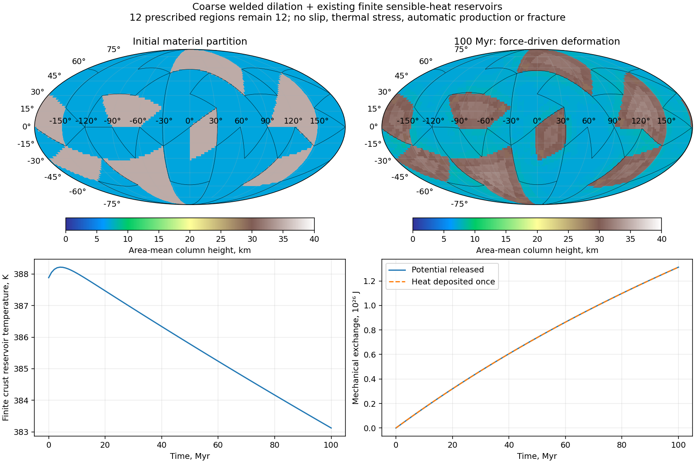
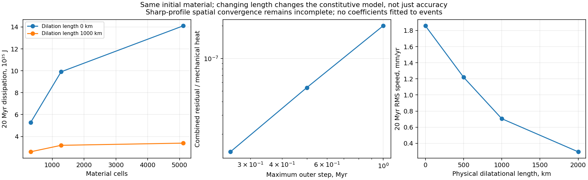

# Coarse shared deformation with a thermal/material work interface

This stage replaces imposed regional rotations in the bounded shared-surface
control with a work-consistent viscous dilation law. It couples the resulting
dissipation to the **existing finite mantle/crust thermal inventory**, and
checks prescribed material transfers with their actual gravitational cost.
The old runner and the previous reference operator are unchanged.

Runtime commit: `9435de7c50e2ecd35b42e2d653e703d40082c36f`, pushed and its remote
SHA verified. Results commit: `1004735` (local). Later Git transport lost
authentication: `could not read Username for 'https://github.com'`. A separate
read through the authorized GitHub connector confirmed the remote work branch
still points to `9435de7`. No force update, main change or credential workaround
was attempted. See the final delivery receipt for backup/publication status.

## What is implemented

`tectonics/regional_deformation.py` adds dissipation of area deformation to
the existing basal resistance. Its length `ell = sqrt(zeta/beta)` is a physical
constitutive parameter, not a grid spacing. One exact spherical-area derivative
is used for the strain rate, force balance and dissipative work. The sparse
positive-definite solve determines both tangent components at every vertex.
There is no imposed Euler motion. The analytic law and its limitations are in
[METHOD.md](METHOD.md).

`tectonics/deformation_exchange.py` uses `MaterialExchangeBudget` as the sole
thermal owner. Mechanical heat is deposited once; the surface's inherited
sensible heat is reference metadata, not another evolving heat reservoir.
Thermal and mechanical steps are split symmetrically, with atomic trial
updates and preserved time-controller state. The old mechanical and thermal
residuals remain independently observable in the combined budget.

The material-control interface retains the old donor-enthalpy and provenance
transfers, but adds independent quadrature of `rho*g*h*dV`. Positive placement
work needs explicit funding. Return heat is actual gravitational release to
the declared support-radius reference, not an energy-balancing remainder.
Simultaneous return cannot disguise unpaid positive placement. A request below
local volume representation is rejected rather than silently losing material.

This is a welded, viscous regional layer. It has no elastic memory, shear
strength, independent tangential slip or thermal eigenstrain. The coefficients
are not temperature-dependent: the new coupling transfers mechanical heat to
the thermal model but does not claim cooling-driven stress or a rheological
thermal feedback. Thermal conductances and radiogenic heating follow the
existing coarse model; orbital heating is zero in these controls.

## Connected 100 Myr result

The same protected zero-time material inventory used by the parent stage is
conservatively prolonged to 1280 triangles. The new mechanical potential was
declared in that parent stage; no lost stress or convection history is inferred.
No production, recycling or fracture source is enabled in this unforced run.

| Quantity | Initial | 100 Myr |
|---|---:|---:|
| Felsic volume, m³ | 3.455143927710239e18 | unchanged |
| Basalt volume, m³ | 1.7677900132812224e18 | unchanged |
| Crust mass, kg | 1.4800994036104215e22 | unchanged |
| Tallest column, km | 34.770823 | 32.533622 |
| Crust reservoir temperature, K | 387.885078 | 383.122841 |
| Mantle reservoir temperature, K | 1860.735848 | 1848.013385 |
| RMS speed, mm/yr | 0.741202 | 0.594107 |
| Prescribed material regions | 12 | 12 |

The finite gravitational reserve supplies **1.31216496e26 J** of dissipated
work. That heat is deposited exactly once. Combined thermal plus mechanical
residual: **+2.105014e19 J**, **1.60423e-7 of this mechanical exchange**. The
residual is not added to heat. Surface heat loss is 5.832495e28 J; explicitly
integrated radiogenic input is 2.733482e28 J. Thermal ledger residual is zero
at the compensated arithmetic precision of this run, not a claim of exact
thermal physics. The crust initially warms slightly and then cools.

Component volumes, owners and represented provenance are unchanged. Total
area is preserved to floating-point roundoff, with no renormalization or
sampled uncovered/overlapping points. The initial and final total-mass sum
diagnostic is -8.598e7 kg relative to 2.030548e24 kg (4.24e-17, below one ULP);
the value is inherited and unchanged, not accumulated loss. Provenance column
residuals are zero. Age moments advance, and both thermal and mechanical
history survive restart.

## Convergence and constitutive uncertainty

All native grid comparisons retain the same 320-cell parent material field
and physical coefficients. At 20 Myr, `ell=1000 km`:

| Cells | Dissipated heat, J | Tallest column, km | Case wall time, s |
|---:|---:|---:|---:|
| 320 | 2.600700e25 | 34.382469 | 1.088 |
| 1280 | 3.193579e25 | 34.288150 | 3.215 |
| 5120 | 3.393040e25 | 34.266227 | 13.656 |

The last heat change is **6.25%**; sharp-profile spatial convergence remains
incomplete. The 1280-to-5120 change with `ell=0` is **42.38%** on the same
20 Myr comparison. Adding viscous dilation changes the physical model, so this
is reduced sensitivity of a declared alternative, not a free numerical fix.
Smooth and oblique 100 Myr controls have about 3.15% and 3.18% last-grid heat
changes. The independent small-amplitude spherical-harmonic rate converges
on 80/320/1280 cells for two physical lengths; its finest-grid error is below
1.2% in the tests.

On 1280 cells, outer steps 1, 0.5 and 0.25 Myr give combined residual/heat
2.0013e-7, 5.3752e-8 and 1.3722e-8. Crust-temperature differences shrink from
0.000865 to 0.000217 K, close to second-order behavior. These tiny time errors
are not a new accuracy requirement: a 1 Myr outer step is sufficient for the
present coarse no-event controls. Spatial/model uncertainty dominates.
There is no fracture event whose timing has been established by these tests.

At 20 Myr, lengths 0/500/1000/2000 km produce RMS speeds
1.859/1.220/0.705/0.294 mm/yr. Beta remains 1e17 Pa s/m. The lengths and beta
are explicit synthetic parameters, not chosen separately on each grid or
fitted to obtain a split. Their strong effect prevents a validated prediction
of actual lunar speeds or relaxation times.

## Material-transfer controls and tests

An explicitly prescribed heterogeneous addition/return at 2 Myr requires
**2.4879869e25 J of external placement work**. Without that work, the entire
request is rejected and its checkpoint is unchanged. With it, the existing
finite donor inventory supplies the mass and donor enthalpy. A 70-digit
energy comparison gives an event work residual of -6.6572e10 J (2.68e-15 of
placement work). At 0.5 Myr steps the corresponding residual is +1.5032e10 J.
The complete controls advance to 10 Myr and restart exactly across the event.
This is **not** spontaneous crust formation or resolved subduction; no melt
availability, latent heat or chemical differentiation is supplied.

**367 tests passed**, one third-party deprecation warning, 19.06 s. Fourteen
new tests check virtual work, the analytic spherical rate, rotation, equilibrium,
positive dissipation, finite-step convergence, no unpaid insertion, return
heat, component/age/provenance preservation, atomic rejection and restart.
The seven historical failures mentioned in the lost environment are not in
the recovered baseline; they are not claimed fixed by this stage.

Restart from 20 to 100 Myr is bitwise identical to the uninterrupted control,
including arrays, thermal inventory, controller and both histories. A fresh
process also gives exactly the same checkpoint. A tiny final representable
time interval is integrated without skipping the target.

## Cost and preservation

Fresh-process 100 Myr: **14.581 s**, **79.54 MiB peak RSS**. With only BLAS/OpenMP
thread limits set to one, the identical run takes **11.632 s**, 79.63 MiB;
all checkpoint contents remain bitwise equal. This is a measured 1.25x wall
speedup (about 8.6 Myr/s), not a change of grid, tolerance or physical law.
The profile identifies sparse factorization as the main cost. No large
architectural optimization or expensive Gyr run was started.

The main sequential 15-case queue completed in 64.55 s. Reference-grid,
funded-transfer, restart and fresh-process checks are recorded separately.
The table generated before the thread comparison contains 22 case records;
the additional identical-physics single-thread control has its own JSON.
All 25 restart directories, parameters, logs and figures are preserved.
`preservation.json` verifies **663 earlier manifested artifacts** unchanged,
including the previous geometry control. No protected checkpoints, old archives
or source histories were overwritten or removed.

## Practical boundary of this result

The original gap/overlap problem now has a shared-geometry force solution and
an audited thermal/material work interface. Automatic coupling of the old
source rates is still unsafe: their independent Euler-velocity jumps are not
opening rates of a welded boundary, and their sensible heat is not automatically
available mechanical work. The new module remains an explicit experimental
coupled mode; the main production runner has not been switched to it.

The next integration must define coarse finite boundary-zone area/volume
exchange from the computed strain and a finite pressure/buoyancy work source,
then compare its predictions across the same grids. The donor's mechanical
reference and phase approximation must be explicit. Fracture additionally
requires stored stress energy; a purely viscous layer does not provide it.
These are physical closures, not reasons to force births, refine microscopic
seams, or pretend the 12 initial regions formed as continents.
