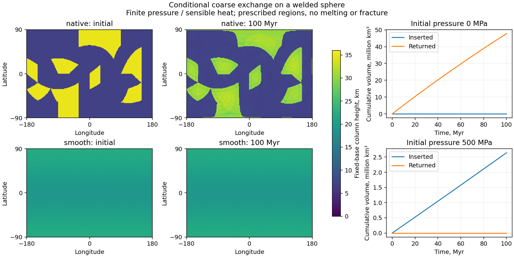
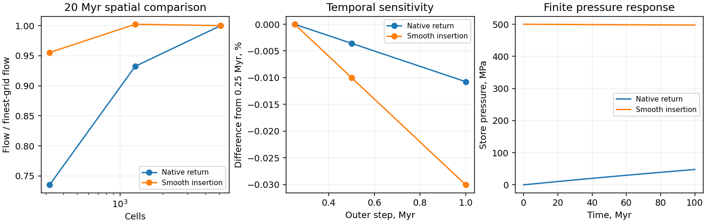

# Computed deformation, finite pressure work and material/thermal exchange

Runtime: **278c6354b6610ba57fe42019aa5e8d8e2fe4db10**, pushed to
`reconstruction/regional-20261113` and remote SHA checked. Parent
`bc2ee6aa2b6ea9c824f78f4dba10e1be0ef69fdb` was also successfully published
before this stage; the previous report's Git-authentication failure is resolved.
These are new reconstruction results, not recovered results of the lost session.

## What is now connected

`tectonics/strain_exchange.py` wraps the existing deforming-sphere and finite
two-box material/thermal runtime. The computed change of actual spherical
area limits insertion/return on initial physical boundary bands. The bands
are material fractions, advected with the shared surface. No raster contact
count, imposed Euler rotation or additional stock at junctions drives them.

A finite compliant pressure store supplies emplacement work and receives work
on return. It has no permanent recharge. Its pressure responds to transferred
volume; its energy and its work are separately recorded. Passive constrained
equilibration selects the actual transfer within the geometric quota. Thus a
geometric request can be blocked by pressure or material availability. Updated
mass enters the next force solve, and donor sensible enthalpy plus independently
calculated hydraulic dissipation enter the existing thermal owner once.
The complete mathematical contract and strong approximations are in METHOD.md.

The default initialization has **zero pressure energy**. Positive initial
pressure controls declare their new initial mechanical energy explicitly; it is
not inferred from old temperature or manufactured during evolution. Reference
volume 1e20 m³ fits inside the existing mantle inventory and is not counted as
another mass or heat pool. C=1e9 or 2e8 m³/Pa, the 500 MPa positive control,
exchange efficiency and initial 500–2000 km band widths are **uncalibrated
synthetic parameters**, not measured properties of this moon.

## Linked 100 Myr results, 1280 cells and 1 Myr outer step

| Quantity | Inherited heterogeneous state, P0=0 | Smooth synthetic profile, P0=500 MPa |
|---|---:|---:|
| Basalt-equivalent inserted | 0 | 2.642113 million km³ |
| Basalt-equivalent returned | 47.768743 million km³ | 0 |
| Final pressure | 47.7687 MPa | 497.3579 MPa |
| Initial pressure energy | 0 | 1.250000e26 J |
| Final pressure energy | 1.140926e24 J | 1.236824e26 J |
| Pressure work to surface | -1.140926e24 J | +1.317566e24 J |
| Hydraulic dissipation | 5.819997e24 J | 1.448970e23 J |
| Total mechanical dissipation | 1.375099e26 J | 4.106102e23 J |
| Combined energy residual | +2.117214e19 J | +5.968052e13 J |
| Residual / mechanical dissipation | 1.540e-7 | 1.453e-10 |
| Tallest final column | 32.5305 km | 21.9689 km |
| Final crust temperature | 382.2458 K | 418.4793 K |
| Final RMS speed | 0.59584 mm/year | 0.04363 mm/year |

In the zero-pressure run, gravity-driven return **charges** the store; its
negative work to the surface is not external extraction from the system.
In the pressurized run, insertion spends about 1.05% of the initial pressure
energy. Neither run has external mechanical input. The explicit old thermal
model includes radiogenic input (2.733482e28 J over 100 Myr), surface cooling
(5.833186e28 / 5.924535e28 J respectively) and zero orbital heating. It is not
an isolated thermal system. Mechanical and pressure residuals are not heated.

The two histories did **not** show simultaneous insertion and return, new
regions, melting or fracture. No parameter was adjusted to require these
outcomes. The initially prescribed 12 / 8 regions retain their labels. These
are conditional extrusion/return controls, not observations of magmatism,
subduction or continental birth. Speeds remain small and uncalibrated; slow
gravity relaxation is not a replacement for mantle convection or a new
cooling-driven stress mechanism.

The map samples spherical face containment at 45,000 points per panel, all
covered exactly once. The earlier `linked100.png` is retained as evidence of
the initial polygon display: its pole gaps are projection/display artifacts,
not gaps in the spherical material partition. Use `linked100_raster.png`.

## Finite-source back reaction, without changing the physical law

The already compared C=2e8 m³/Pa zero-pressure state was continued from 20 to
100 Myr. It finishes with **30.645297 million km³ returned**, pressure
153.2265 MPa, and no insertion. Rising pressure starts limiting the return
quota around 58–59 Myr; at 100 Myr only 5.69% of that step's geometrically
permitted return occurs. This is a finite work/pressure limitation, not deletion
of material, an imposed flow cap, or a numerical failure. The larger-compliance
run returns 47.768743 million km³ on the same initial geometry and other laws.

From the **same saved 50 Myr state and physical memory**, steps 1, 0.5 and
0.25 Myr give first pressure-limited endpoints 59, 58.5 and 58.25 Myr. At 65 Myr
the returned totals are 29.643223, 29.664544 and 29.674544 million km³. Successive
changes are 0.0719% and 0.0337%. This is consistent with the first-order outer
split. The diagnostic brackets the transition; it is **not exact event
localization**. No fracture timing or event guarantee is established.

## Spatial, temporal and parameter sensitivity

Same physical fields, coefficients and 20 Myr duration:

| Cells | Native returned, million km³ | Smooth inserted, million km³ |
|---:|---:|---:|
| 320 | 8.144357 | 0.498309 |
| 1280 | 10.326314 | 0.522785 |
| 5120 | 11.076594 | 0.521613 |

The last change is **+7.27%** for the inherited sharp profile and **-0.224%**
for the smooth one. The oblique profile changes from 0.796594 to 0.778867
million km³ inserted (**-2.23%**, 1280 to 5120 cells). The sharp case remains
spatially unresolved at a few-percent target. A small last-grid difference in
the smooth case is encouraging, not a universal proof of convergence.

Halving outer step 1→0.5→0.25 Myr changes native return by 0.00717%, then
0.00358%, and smooth insertion by 0.02005%, then 0.01002%. First-order transfer
error, rather than the inherited second-order mechanical step, is visible.
Extra band quadrature refinement 2→3 changes smooth insertion by **-0.0786%**;
band integration alone does not account for the remaining sharp-profile error.

At fixed resolution, changing initial band width 500→1000→2000 km changes
smooth insertion to 0.281170→0.522785→0.872446 million km³. Changing P0 from
500 to 300 MPa changes the same smooth case to **zero insertion and 0.445621
million km³ return**. A different compliance initially leaves quota-limited
insertion unchanged but changes pressure loss and heat. Model-parameter
uncertainty can be much larger than time-integration error. These variations
are reported, not fitted to a desired amount of crust.

## Independent budgets, restart and regressions

**379 tests passed**, one third-party deprecation warning, 18.13 s. Twelve new
tests cover an independent thin-column analytic solution, passive KKT solution,
zero-pressure charging, blocked directions, finite source, high-precision small
work, physical-band rotation/integration, combined budgets, age/material memory,
atomic rejection, restart and temporal refinement. Near-equilibrium failures
found during development are retained in the earlier logs: the pressure bracket
needed outward rounding, and an inverse/forward volume ULP mismatch could cause
spurious pumping. The corrected active-set check uses the stored state. No
physical threshold or energy tolerance was relaxed.

At actual one-Myr deformation endpoints, a separate **70-digit** calculation of
thermal plus column plus pressure energy gives transfer residuals +2.00203e5 J
and +6.69573e4 J, respectively 2.63e-18 and 5.14e-18 of their exchanged work.
Both isolated exchanges increase the modeled sensible-heat entropy. This checks
small exchanges independently of the much larger whole-mantle heat budget;
it does not validate the missing phase thermodynamics.

Complete checkpoints from **20→100 Myr** exactly reproduce both uninterrupted
histories, including geometry, enthalpy, pressure, material age/provenance,
controllers and ledgers. Fresh-process native 100 Myr is also bitwise identical.
All scenario saves load exactly. The 50→65 Myr pressure-transition states are
saved separately; only the numerical outer step changes in those comparisons.

Origin-mass column residuals are zero in the two main long runs. Their total
mass-sum diagnostics are -1.03809e8 and +1.55189e8 kg relative to about 2.03e24 kg
(within one floating-point ULP), not missing reservoirs. Component transfers
are checked independently against local geometric inventories. Felsic material,
owners and their histories are retained. Thermal-ledger residual is zero at
the compensated arithmetic precision, not a claim of exact physical modeling.

The seven failures mentioned in the lost environment are not present in this
recovered test set; this stage does not claim to have fixed them.

## Practical cost and boundary of readiness

Fresh-process **100 Myr: 15.290 s, 80.82 MiB peak RSS**, about 6.54 Myr/s,
including initialization, saving, reloading and coverage check. BLAS/OpenMP
threads were set to one, as in the parent measurement. The previous no-exchange
operator measured 11.632 s on this host, but that is a different model; the new
time is not advertised as a speedup. The 20-case sequential comparison took
139.79 s. The additional finite-capacity continuation took 10.79 s and its
three time-refinement controls 13.21 s. No Gyr run was started.

The current coarse linked module is practical for these fixed-topology tests.
It has **not** replaced the main production runner or GUI. Boundaries are welded;
there is no independent slip, stored plate elastic stress, new fracture,
remeshing, active phase supply, latent heat, temperature-dependent pressure law,
or resolved spatial mantle convection. A common instantaneously communicating
pressure store and strain-gated rapid transfer are especially strong closures.
High-pressure cases may violate real host-rock strength; that strength is not
established here. Conservation cannot establish lunar geological realism.

The next useful physical closure is a finite thermally/phase-limited **mobile
material inventory**, so that the existing mantle temperature does not silently
imply arbitrary basalt supply. New boundaries will additionally need stored
thermomechanical energy and a paid fracture operator; the current viscous mode
has neither. The remaining 7.27% sharp-field flow sensitivity must be carried
as numerical uncertainty while those coarse laws are assessed.

All **766 previous manifested artifacts** are unchanged. No prior archive,
checkpoint, protected source evidence or hardlink pair was edited or deleted.
The stage's states, raw logs, parameter tables, sources and maps are preserved
in the working branch; final artifact hashes and byte counts are in
`artifact_manifest.json`. See RESTORE.md for reproduction and continuation.
